# H

**@himanvic**

Learning by building. Improving one project at a time.

[Repositories](https://github.com/himanvic?tab=repositories)

---

## About

Learning software development through experimentation, problem-solving, and building projects.

- Focused on **C++ and Python**
- Practising programming fundamentals
- Building, testing, and improving projects

## Current focus

  
  &nbsp;&nbsp;
  

## Selected projects

<table width="75%">
  <tr>
    <td width="33%" align="left">
      <a href="https://github.com/himanvic/Mausam-India"><strong>☁️ Mausam India</strong></a> 
      Weather insights for a better tomorrow.
    </td>
<<<<<<< HEAD
    <td width="33%" align="left">
      <a href="https://github.com/himanvic/rail-route-website"><strong>🚆 Rail &amp; Route</strong></a> 
      Plan. Track. Travel.
    </td>
    <td width="33%" align="left">
      <a href="https://github.com/himanvic/NaradNow"><strong>📰 NaradNow</strong></a> 
      Real news. Real time.
=======
    <td width="50%" align="center">
      
       <a href="https://github.com/himanvic/Mausam-India">repo</a> · <a href="https://mausam-india.pages.dev">live</a>
    </td>
  </tr>
  <tr>
    <td width="50%" align="center">
      
       <a href="https://github.com/himanvic/himanvic-portfolio">repo</a> · <a href="https://himanvic.pages.dev/">live</a>
    </td>
    <td width="50%" align="center">
      
       <a href="https://github.com/himanvic/NaradNow">repo</a> · <a href="https://naradnow.pages.dev/">live</a>
    </td>
  </tr>
  <tr>
    <td width="50%" align="center">
      
       <a href="https://github.com/himanvic/bottelneck.sys">repo</a>
    </td>
    <td width="50%" align="center">
      
       <a href="https://github.com/himanvic/sanskode">repo</a> · <a href="https://sanskode.pages.dev">live</a>
>>>>>>> 9e8909a3385060773055adf19569ea2099ce3a29
    </td>
  </tr>
</table>

 

---

Still learning. Still building.
