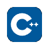
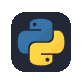
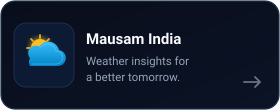
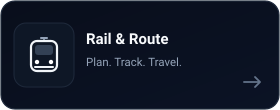
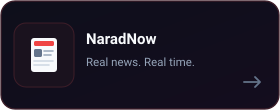

# H

**@himanvic**

Learning by building. Improving one project at a time.

 

 

[Repositories](https://github.com/himanvic?tab=repositories)

---

## About

Learning software development through experimentation, problem-solving, and building projects.

- Focused on **C++** and **Python**
- Practising programming fundamentals
- Building, testing, and improving projects

---

## Current focus

  
  &nbsp;&nbsp;
  

---

## Selected projects

<table border="0" width="100%">
  <tr>
    <td width="33%" align="center">
      
    </td>
    <td width="33%" align="center">
      
    </td>
    <td width="33%" align="center">
      
    </td>
  </tr>
</table>

 

---

  Still learning. Still building.

