<!--
  GitHub profile README for https://github.com/himanvic
  The repo must be PUBLIC and named exactly: himanvic

  Upload everything in this package to the ROOT of that repo (keep the folders):
    README.md · h-profile-banner.svg · h-profile-banner-light.svg
    assets/ · scripts/update_profile.py · .github/workflows/*.yml

  Then, once: repo > Actions tab > run each workflow ("Update Live Profile Data",
  "Generate Snake Animation", "GitHub-Profile-3D-Contrib") with "Run workflow".
  After that everything below refreshes by itself from your real GitHub data.

  The block between the REPOS markers is rewritten automatically - don't hand-edit it.
-->

<div align="center">
  <picture>
    <source media="(prefers-color-scheme: light)" srcset="h-profile-banner-light.svg" />
    
  </picture>
</div>

<div align="center">
  
</div>

<p align="center">
  <a href="https://himanvic.pages.dev/"></a>
  <a href="https://github.com/himanvic?tab=repositories"></a>
  
</p>

<p align="center">
  
  
  
</p>


## `01 // MISSION DIRECTIVE`

I learn by writing code, testing ideas, debugging mistakes, and gradually turning concepts into working projects. This profile documents that process, not a claim of expertise.

<div align="center">
  
</div>


## `02 // LEARNING MATRIX`

<div align="center">
  
</div>

| Module | Current work |
|:--|:--|
| **C++** | Syntax, variables, conditions, loops, functions, and problem-solving practice |
| **Python** | Fundamentals, readable code, scripting, and small practical exercises |
| **Problem solving** | Breaking problems into steps, tracing logic, and learning from errors |
| **Developer workflow** | Using VS Code, Git, and GitHub to track project changes |

<sub>These are my current learning areas, not proficiency or certification claims.</sub>


## `03 // PROJECT ARCHIVE`

<sub>Auto-generated from my real public repositories (name, description, language, stars, last push, weekly commits).</sub>

<!--REPOS:START-->
<table>
  <tr>
    <td width="50%" align="center">
      <a href="https://rail-route-website.pages.dev"></a>
      <br /><sub><a href="https://github.com/himanvic/rail-route-website">repo</a> · <a href="https://rail-route-website.pages.dev">live</a></sub>
    </td>
    <td width="50%" align="center">
      <a href="https://naradnow.pages.dev/"></a>
      <br /><sub><a href="https://github.com/himanvic/NaradNow">repo</a> · <a href="https://naradnow.pages.dev/">live</a></sub>
    </td>
  </tr>
  <tr>
    <td width="50%" align="center">
      <a href="https://github.com/himanvic/bottelneck.sys"></a>
      <br /><sub><a href="https://github.com/himanvic/bottelneck.sys">repo</a></sub>
    </td>
    <td width="50%" align="center">
      <a href="https://mausam-india.pages.dev"></a>
      <br /><sub><a href="https://github.com/himanvic/Mausam-India">repo</a> · <a href="https://mausam-india.pages.dev">live</a></sub>
    </td>
  </tr>
  <tr>
    <td width="50%" align="center">
      <a href="https://sanskode.pages.dev"></a>
      <br /><sub><a href="https://github.com/himanvic/sanskode">repo</a> · <a href="https://sanskode.pages.dev">live</a></sub>
    </td>
    <td width="50%" align="center">
      <a href="https://himanvic.github.io/Quantum-Gravity-Shift/"></a>
      <br /><sub><a href="https://github.com/himanvic/Quantum-Gravity-Shift">repo</a> · <a href="https://himanvic.github.io/Quantum-Gravity-Shift/">live</a></sub>
    </td>
  </tr>
</table>
<!--REPOS:END-->

<p align="center"><a href="https://github.com/himanvic?tab=repositories"><strong>OPEN ALL PUBLIC REPOSITORIES ↗</strong></a></p>


## `04 // ACTIVE STACK`

<div align="center">
  
</div>

These are the two languages I'm currently focusing on. My web projects are listed as experiments I've built; they are not claims of expertise or a separate current learning track.


## `05 // ACTIVITY TELEMETRY`

<div align="center">
  
</div>

<div align="center">
  
  
</div>

<div align="center">
  <picture>
    <source media="(prefers-color-scheme: dark)" srcset="https://raw.githubusercontent.com/himanvic/himanvic/output/github-snake-dark.svg" />
    <source media="(prefers-color-scheme: light)" srcset="https://raw.githubusercontent.com/himanvic/himanvic/output/github-snake.svg" />
    
  </picture>
</div>

<div align="center">
  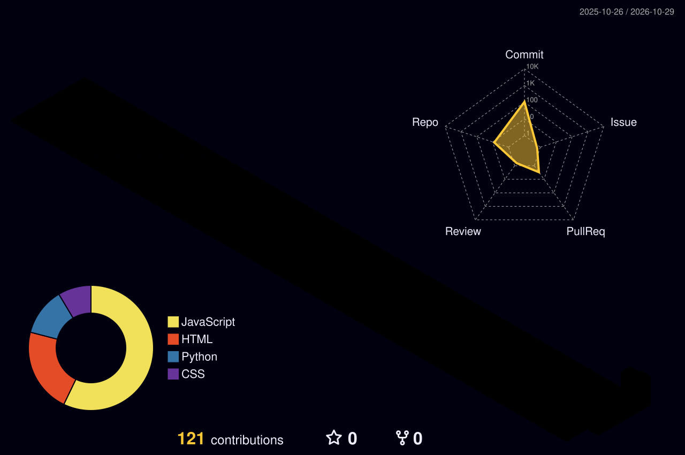
</div>

<sub>Everything above is built from public GitHub data and refreshes automatically. Third-party cards can take time to refresh or occasionally be unavailable; none of this measures programming skill.</sub>

<details>
<summary><code>▶ ACCESS HIDDEN TRANSMISSION</code></summary>

```text
   _   _
  | | | |    > status ........ learning
  | |_| |    > focus ......... C++ / Python
  |  _  |    > method ........ learn -> build -> improve
  |_| |_|    > loop ......... debug. refine. repeat.
```

</details>


## `06 // OUTBOUND LINK`

<p align="center">
  <a href="https://himanvic.pages.dev/"></a>
  &nbsp;
  <a href="https://github.com/himanvic?tab=repositories"></a>
</p>

<div align="center">
  
</div>

<div align="center">
  <sub>H / END OF TRANSMISSION</sub>
</div>
